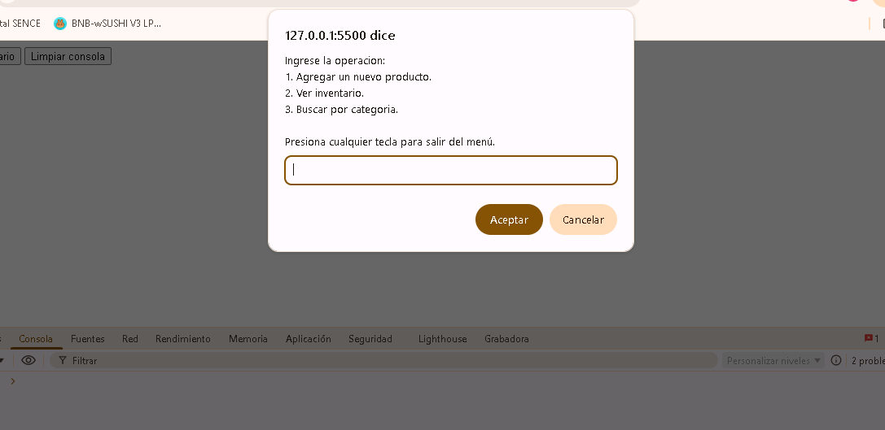
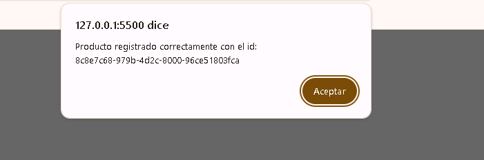
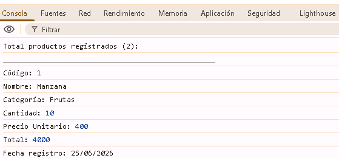

# Proyecto ABP M3

Este proyecto es una aplicación web simple para gestionar un inventario de productos desde el navegador.

## Estructura del proyecto

- `index.html` - Página principal con botones para iniciar el menú de inventario, ver el inventario actual y limpiar la consola.
- `assets/js/proyecto.js` - Lógica principal de la aplicación.
- `assets/img/` - Carpeta disponible para imágenes, si se requiere ampliar la interfaz.

## Funcionalidades creadas

### 1. Registro de productos

- Permite agregar productos con los siguientes campos:
  - Código
  - Nombre
  - Categoría
  - Cantidad
  - Precio unitario
- Cada producto se guarda con un `id` único generado mediante `uuidv4()`.
- La fecha de ingreso se registra automáticamente con `moment.js` en formato `DD/MM/YYYY`.

### 2. Validaciones de entrada

- Validación de cantidad: solicita un valor numérico mayor a 0.
- Validación de precio: solicita un valor numérico mayor o igual a 0.
- Validación de categoría: obliga a elegir entre las categorías válidas (`Frutas`, `Verduras`, `Carnes`, `Lacteos`), normalizando la entrada del usuario.
- Validación de código y nombre: no se aceptan valores nulos ni cadenas vacías.

### 3. Vista de inventario

- Muestra en la consola todos los productos registrados.
- Incluye datos detallados de cada producto:
  - Código
  - Nombre
  - Categoría
  - Cantidad
  - Precio unitario
  - Total calculado (`cantidad * precioUnitario`)
  - Fecha de registro

### 4. Búsqueda por categoría

- Permite filtrar productos según la categoría seleccionada.
- Muestra únicamente los productos que pertenecen a la categoría elegida.

### 5. Cálculo del valor total del inventario

- Permite calcular el valor total de todos los productos registrados.
- Usa una función y `reduce()` para sumar el total de cada producto.

### 6. Controles en la interfaz

- Botón `Iniciar` abre el menú principal para agregar productos, ver inventario, buscar por categoría o calcular el valor total.
- Botón `Ver inventario` muestra directamente el inventario completo en la consola.
- Botón `Limpiar consola` borra la salida de la consola del navegador.

## Cumplimiento de los requerimientos del PDF

- Ejecuta la aplicación en la consola del navegador.
- Solicita datos al usuario mediante `prompt()`.
- Implementa funciones reutilizables para cada operación.
- Usa condicionales (`if`, `switch`) y estructuras de repetición (`for`, `while`).
- Trabaja con arreglos y objetos para almacenar y manipular datos.
- Incluye validaciones de entrada para evitar errores.
- Proporciona documentación y explicaciones en el código.

## Tecnologías usadas

- JavaScript nativo
- `uuidv4` para generación de identificadores únicos
- `moment.js` para manejo de fechas
- HTML básico para la estructura de la interfaz

## Uso

1. Abrir `index.html` en un navegador.
2. Usar el botón `Iniciar` para agregar productos o navegar por el menú.
3. Usar el botón `Ver inventario` para revisar el listado actual en la consola del navegador.
4. Usar el botón `Limpiar consola` para limpiar la salida.

## Notas

- El inventario se mantiene en memoria mientras la página esté abierta; no hay persistencia en localStorage ni base de datos.
- Las operaciones y resultados se muestran principalmente en la consola del navegador.

## Evidencias de uso

1.- Menú de opciones

2.- Creación de productos

3.- Inventario de productos

